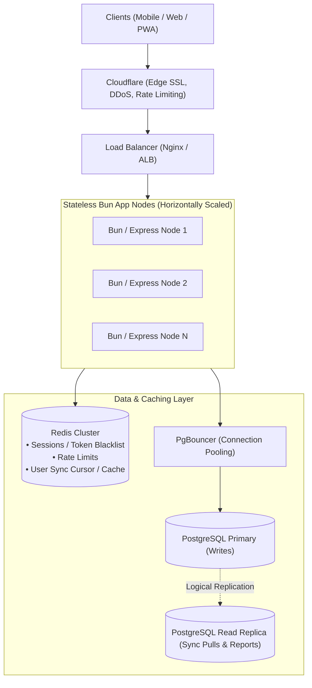

# Scalable System Design & Architecture (100k to 1M+ Users)

## 1. Domain Characteristics & Scaling Superpower

- **Strict Tenant Isolation**: In personal finance, users **only** query their own data (`WHERE userId = ?`). There are no cross-user queries or joins.
- **Workload**: High-frequency sync reads/writes (pulling updates since cursor, pushing batched local changes), balance aggregations, and filtered queries (by month/category).
- **Crucial Rule**: Financial amounts must **never use floating-point types** (`Float`). Use `Decimal(14, 2)` or store as integer cents (`BigInt`).

---

## 2. Architecture Evolution



### Phase 1: 0 to 100k Users (Simplicity & High Throughput)

- **Compute**: 2–3 stateless Bun/Express instances behind an Application Load Balancer or Nginx.
- **Database**: Single managed PostgreSQL instance (e.g., AWS RDS / Supabase / Neon, 4–8 vCPUs) with **PgBouncer** connection pooler.
- **Cache**: Managed Redis for rate limiting, JWT token revocation, and user balance caches.
- **Capacity**: A single properly indexed Postgres instance easily handles up to 5,000–10,000 queries/second.

### Phase 2: 100k to 1M+ Users (Scale Out)

- **Read/Write Splitting**: Route writes to Postgres Primary; route heavy read-heavy delta-sync queries (`GET /sync`) to Read Replicas.
- **Table Partitioning**: PostgreSQL declarative partitioning on `transactions` and `debts` by range (e.g. `date` by year/quarter) or hash on `userId`.
- **ID Strategy**: Use **UUID v7** or **ULID** instead of random UUID v4. Time-ordered IDs keep B-Tree indexes contiguous in memory and prevent database page fragmentation on heavy write bursts.

---

## 3. Recommended Production Database Schema

Key improvements applied:

1. `Decimal(14, 2)` replaces imprecise `Float`.
2. Native Postgres Enums (`TransactionType`, `DebtDirection`).
3. Monotonic `version` counters and compound indexes (`[userId, updatedAt]`, `[userId, date]`) for delta-sync queries.
4. Foreign key cascades & soft-delete flags.

```prisma
datasource db {
  provider = "postgresql"
}

generator client {
  provider = "prisma-client-js"
}

// ---------------------------------------------------------
// ENUMS
// ---------------------------------------------------------

enum TransactionType {
  INCOME
  EXPENSE
  TRANSFER
}

enum DebtDirection {
  LENT      // User gave money to someone
  BORROWED  // User received money from someone
}

// ---------------------------------------------------------
// MODELS
// ---------------------------------------------------------

model User {
  id                     String        @id @default(uuid())
  googleId               String?       @unique
  email                  String?       @unique
  name                   String
  avatar                 String?
  bio                    String?
  currency               String        @default("USD")
  hasCompletedOnboarding Boolean       @default(false)

  // Sync state tracking
  syncVersion            BigInt        @default(1)

  transactions           Transaction[]
  debts                  Debt[]

  createdAt              DateTime      @default(now())
  updatedAt              DateTime      @updatedAt

  @@index([email])
}

model Transaction {
  id          String          @id @default(uuid()) // Recommend UUIDv7
  userId      String
  title       String          @db.VarChar(150)
  amount      Decimal         @db.Decimal(14, 2)
  type        TransactionType
  date        DateTime
  tag         String?         @db.VarChar(50)
  note        String?         @db.VarChar(500)
  isDeleted   Boolean         @default(false)

  // Monotonic versioning for fast local-first delta-sync
  version     BigInt          @default(1)

  user        User            @relation(fields: [userId], references: [id], onDelete: Cascade)

  createdAt   DateTime        @default(now())
  updatedAt   DateTime        @updatedAt

  // Indexes tuned for common queries and sync pulls
  @@index([userId, isDeleted, date(sort: Desc)])
  @@index([userId, updatedAt(sort: Asc)])
}

model Debt {
  id          String          @id @default(uuid())
  userId      String
  personName  String          @db.VarChar(120)
  title       String          @db.VarChar(150)
  amount      Decimal         @db.Decimal(14, 2)
  date        DateTime
  direction   DebtDirection
  isSettled   Boolean         @default(false)
  note        String?         @db.VarChar(500)
  isDeleted   Boolean         @default(false)

  version     BigInt          @default(1)

  user        User            @relation(fields: [userId], references: [id], onDelete: Cascade)
  repayments  Repayment[]

  createdAt   DateTime        @default(now())
  updatedAt   DateTime        @updatedAt

  @@index([userId, isDeleted, isSettled])
  @@index([userId, updatedAt(sort: Asc)])
}

model Repayment {
  id                 String   @id @default(uuid())
  debtId             String
  amount             Decimal  @db.Decimal(14, 2)
  date               DateTime
  note               String?  @db.VarChar(500)
  affectsCashBalance Boolean  @default(true)
  isDeleted          Boolean  @default(false)

  version            BigInt   @default(1)

  debt               Debt     @relation(fields: [debtId], references: [id], onDelete: Cascade)

  createdAt          DateTime @default(now())
  updatedAt          DateTime @updatedAt

  @@index([debtId, isDeleted])
  @@index([debtId, updatedAt(sort: Asc)])
}
```

---

## 4. Key Performance Strategies

### 1. Delta Sync Protocol (Local-First Offline-Ready)

Instead of fetching all transactions on startup:

- Client stores `lastSyncedAt` or `lastSyncVersion`.
- Query only what changed:
  ```sql
  SELECT * FROM "Transaction"
  WHERE "userId" = :userId AND "updatedAt" > :lastSyncedAt
  ORDER BY "updatedAt" ASC LIMIT 500;
  ```
- Soft deletes (`isDeleted = true`) are sent down so the client knows what to delete locally.

### 2. Connection Pooling (Critical for 100k+ Users)

- Bun handles tens of thousands of HTTP requests with low memory, but PostgreSQL cannot handle 10,000 direct open database connections.
- **Solution**: Always connect Bun to PostgreSQL through **PgBouncer** (Transaction pooling mode). Keeps actual database connections around 50–100 while serving millions of client requests.

### 3. Caching Strategy

- **Summary & Monthly Totals**: Cache monthly balance aggregations in Redis under `user:{id}:totals:{year_month}` with a 1-day TTL or invalidate upon transaction writes.
- **Authentication**: Store active sessions or invalidated JWT IDs (`jti`) in Redis to avoid hitting the DB on every single HTTP request.
