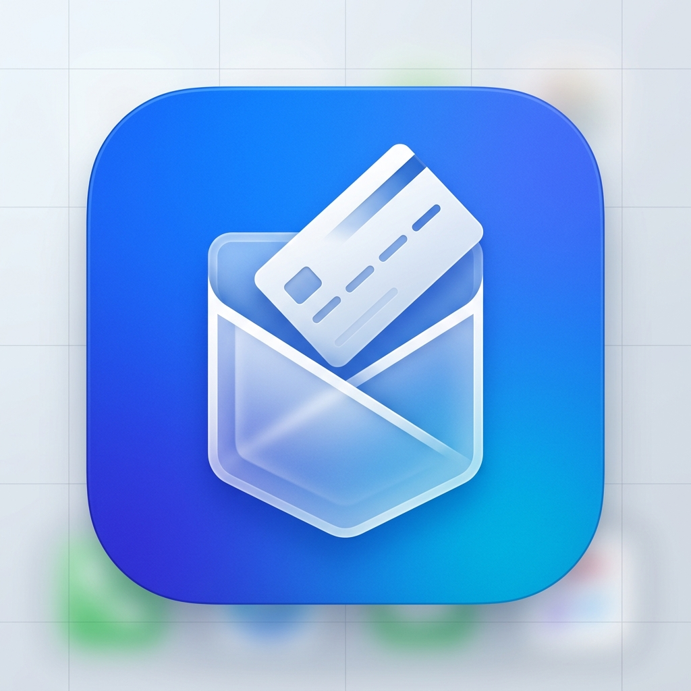

# Pocket

<p align="center">
  
</p>

<p align="center">
  <strong>Pocket</strong> is a sleek, minimal, 100% offline personal expense and debt tracking application built with Flutter & GetX.
</p>

<p align="center">
  <a href="#features">Features</a> •
  <a href="#design--ui">Design & UI</a> •
  <a href="#getting-started">Getting Started</a> •
  <a href="#architecture">Architecture</a>
</p>

---

## ✨ Features

- ⚡ **100% Offline & Private:** Zero external servers or tracking. All data is saved strictly to your device via `shared_preferences` (and browser `window.localStorage` on Web).
- 💾 **Local Backup & Restore:** Export your entire financial history to a portable JSON string anytime, and restore it with a single tap.
- 💰 **Total Cash & Adjusted Balance:** View your raw cash-in-hand alongside your real adjusted net balance taking into account loans and debts.
- 🤝 **Complete Debt & Loan Tracker:**
  - Track **"They Owe Me"** (receivables) and **"I Owe Them"** (payables).
  - Record partial or full repayments.
  - Optional automatic sync with your cash balance upon repayment.
- 📊 **Period Spending Visualizer:** Clean Donut Chart breaking down expenses across custom periods: **Week**, **Month**, **Year**, and **All**.
- 🇧🇩 **Localized Currency:** Defaults to Bangladeshi Taka (`৳`) with smooth decimal precision and clean thousand separators.

---

## 🎨 Design & UI Highlights

- **Vibrant `#3D83F5` Theme:** Signature electric blue brand identity paired with tailored Light and Dark modes.
- **Borderless Flat Aesthetics:** Clean, shadowless, borderless cards (`BorderlessCard`) with ultra-light surfaces (`#F8FAFC`).
- **Plus Jakarta Sans:** Premium, geometric fintech typography powered by `google_fonts`.
- **Reusable Component Architecture:**
  - `AppFilterPill` — Smooth animated period and status pills.
  - `ScreenContainer` — Responsive screen wrapper with auto-centering for Web/Desktop.
  - `AppTextField` — Soft, borderless input fields.
  - `BorderlessCard` — Minimalist surface containers.

---

## 🚀 Getting Started

### Prerequisites
- [Flutter SDK](https://docs.flutter.dev/get-started/install) (3.13+ recommended)
- Dart SDK

### Installation

```bash
# Clone the repository
git clone https://github.com/robindev2007/pocket.git

# Navigate into the project directory
cd pocket/app

# Fetch dependencies
flutter pub get

# Run on your preferred platform
flutter run
```

### Run on Web
```bash
flutter run -d chrome
```

### Run Tests
```bash
flutter test
```

---

## 🏗️ Architecture

```
lib/
├── core/
│   ├── constants/       # AppConstants, AppSizes
│   ├── theme/           # AppTheme (#3D83F5), AppCustomColors, ThemeController
│   ├── utils/           # CurrencyFormatter, Date formatting
│   └── widgets/         # AppButton, AppTextField, AppFilterPill, BorderlessCard, ScreenContainer
├── data/
│   ├── models/          # TransactionModel, DebtModel, UserProfileModel
│   └── services/        # StorageService (local offline persistence & backup)
└── features/
    └── tracker/
        ├── controllers/ # TrackerController (GetX state management)
        └── presentation/
            ├── dialogs/ # Add/Edit Transaction, Debt, Profile, Backup dialogs
            └── screens/ # MainNavigationScreen, Dashboard, Transactions, Debts, Profile
```

---

## 📄 License
This project is open-source and free to use.
